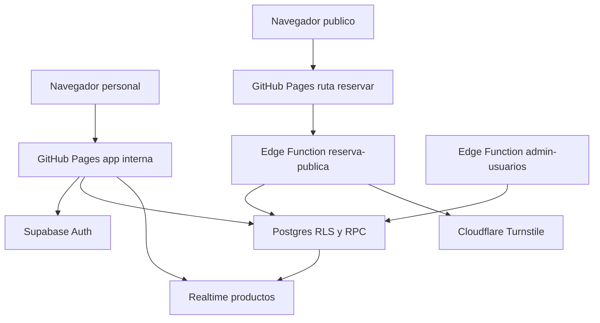

# LankaPets v2.0 — Plan de Desarrollo e Implementación

> Repositorio destino: `/mnt/datos/Repositorio_Github/inventarios` (repo GitHub Pages `inventarios`)
> Carpeta de la aplicación: `RCP_Veterinaria/` (decisión confirmada: reutiliza la carpeta existente)
> Fecha: noviembre 2026 · Estado: plan aprobado, en implementación

---

## 1. Contexto del repositorio y decisión de integración

El repositorio `inventarios` ya es un sitio GitHub Pages con un portal en la raíz
([`index.html`](../index.html)) y varias aplicaciones en subcarpetas
(`Petra/`, `Pagina_Gorras/`, `nueva-app/`, `RCP_Veterinaria/` vacía).
El workflow actual [`.github/workflows/deploy-nueva-app.yml`](../.github/workflows/deploy-nueva-app.yml)
publica la raíz completa y genera `nueva-app/config.js` desde secretos.

### Decisión

Crear la aplicación autocontenida en `RCP_Veterinaria/` con:

- Aplicación interna y página pública en un mismo bundle Vite (HashRouter).
- Esquema Supabase versionado en `RCP_Veterinaria/supabase/`.
- Documentación y pruebas dentro de la misma carpeta.
- URL esperada: `https://<usuario>.github.io/inventarios/RCP_Veterinaria/`.
- Ruta pública: `https://<usuario>.github.io/inventarios/RCP_Veterinaria/#/reservar`.

### Ajuste al workflow de Pages

El workflow actual sube la raíz tal cual. Para no romper el portal existente ni
publicar `node_modules`, se reemplaza por una etapa de ensamblado:

1. `actions/checkout@v4`.
2. `npm ci` y `npm run build` dentro de `RCP_Veterinaria/` con
   `VITE_BASE_PATH=/inventarios/RCP_Veterinaria/` y `VITE_*` inyectadas desde secretos.
3. Copiar el contenido del repo a un directorio `staging/` excluyendo
   `node_modules`, `RCP_Veterinaria/src`, `RCP_Veterinaria/supabase` y archivos de build.
4. Copiar `RCP_Veterinaria/dist/*` a `staging/RCP_Veterinaria/`.
5. Generar `staging/nueva-app/config.js` como hoy y `staging/RCP_Veterinaria/config.js`
   si se opta por configuración runtime; alternativa recomendada: variables
   `VITE_` en build.
6. `actions/upload-pages-artifact@v3` con `path: staging` y `deploy-pages@v4`.

> Las claves publicables de Supabase no son secretas en sentido estricto, pero se
> inyectan por variables de entorno para no hardcodear y permitir dev/prod.

### Estructura de carpetas propuesta

```text
RCP_Veterinaria/
├── README.md
├── package.json
├── vite.config.ts
├── tsconfig.json
├── tsconfig.node.json
├── tailwind.config.ts
├── postcss.config.js
├── index.html
├── .env.example
├── src/
│   ├── main.tsx
│   ├── App.tsx
│   ├── router.tsx
│   ├── lib/
│   │   ├── supabase.ts
│   │   ├── queryClient.ts
│   │   ├── rut.ts
│   │   ├── format.ts
│   │   └── schemas.ts
│   ├── components/
│   │   ├── layout/AppShell.tsx
│   │   ├── layout/RequireAuth.tsx
│   │   ├── ui/...
│   │   └── scanner/BarcodeScanner.tsx
│   ├── features/
│   │   ├── auth/
│   │   ├── inventario/
│   │   ├── ventas/
│   │   ├── clientes/
│   │   ├── agenda/
│   │   ├── reportes/
│   │   └── publico/
│   └── styles/index.css
├── public/
├── supabase/
│   ├── config.toml
│   ├── migrations/
│   │   ├── 0001_extensions_tipos_private.sql
│   │   ├── 0002_config_perfiles_auditoria.sql
│   │   ├── 0003_inventario.sql
│   │   ├── 0004_ventas_devoluciones_rpc.sql
│   │   ├── 0005_clientes_mascotas.sql
│   │   ├── 0006_agenda.sql
│   │   ├── 0007_publico_antiabuso_reportes.sql
│   │   └── 0008_seed_dev.sql
│   ├── functions/
│   │   ├── admin-usuarios/index.ts
│   │   └── reserva-publica/index.ts
│   └── tests/
│       ├── rls_inventario.sql
│       ├── rls_ventas.sql
│       ├── rls_clientes.sql
│       └── rpc_ventas.sql
├── tests/
│   └── e2e/
│       ├── login.spec.ts
│       ├── venta_pistola.spec.ts
│       └── reserva_publica.spec.ts
└── docs/
    ├── modelo-datos.md
    ├── rpc-contratos.md
    ├── despliegue.md
    └── operacion.md
```

---

## 2. Arquitectura objetivo



### Principios no negociables

1. Seguridad real en Postgres: `GRANT` + RLS + RPC. El frontend es hostil por definición.
2. Escrituras sensibles solo por RPC transaccionales; el servidor calcula precio, IVA, total y stock.
3. Costos aislados en tablas separadas con RLS solo Maestro.
4. Superficie anónima mínima: 3 lecturas públicas + 1 Edge Function de escritura.
5. Registros contables inmutables: se anulan, no se borran.
6. Esquema `public` expuesto a Data API; helpers en esquema `private`.

---

## 3. Fases de implementación

### Fase 0 — Preparación de repositorio y entornos

- Crear `LankaPets/` y su `README.md`.
- Crear proyectos Supabase `lankapets-dev` y `lankapets-prod`.
- Registrar en dev las claves nuevas `sb_publishable_...` y `sb_secret_...`.
- Configurar MCP de Supabase con escritura solo en dev; prod en solo lectura o sin MCP.
- Definir secretos de GitHub: `VITE_SUPABASE_URL`, `VITE_SUPABASE_ANON_KEY`
  (o publishable), `SUPABASE_ACCESS_TOKEN` solo si se automatiza.
- Configurar Pages para publicar vía GitHub Actions.
- Activar plan Pro en producción antes de datos reales.

**Criterio de aceptación:** `LankaPets/` existe en el repo, ambos proyectos Supabase
creados, workflow de Pages adaptado y build vacío publicando sin romper el portal.

### Fase 1 — Núcleo de base de datos

Migraciones `0001` y `0002`:

- Extensiones `pgcrypto`, `citext`, `btree_gist`.
- Esquema `private` y funciones `private.es_maestro()`, `private.es_personal()`.
- Tipos enumerados completos.
- `configuracion` con una sola fila y `iva_porcentaje = 19.00`.
- `perfiles` con FK a `auth.users` y trigger que protege al último Maestro activo.
- `auditoria` y función genérica de auditoría con triggers iniciales.
- Cada migración incluye tabla + RLS + `GRANT` explícito + políticas en el mismo archivo.

**Criterio de aceptación:** pruebas SQL demuestran que un usuario anónimo no lee
`perfiles` ni `configuracion`, y que un vendedor no puede autopromoverse.

### Fase 2 — Inventario, costos e ingresos

Migración `0003`:

- `productos` con `CHECK stock >= 0`, código de barras único parcial,
  precios e IVA calculados por trigger.
- `REVOKE UPDATE (stock)` para `authenticated`; `stock` solo cambia por RPC.
- `productos_costos`, `proveedores`, `ingresos_inventario`, `ingreso_items`,
  `movimientos_inventario`.
- RLS: vendedor lee y edita productos comerciales; costos solo Maestro.
- `v_inventario` con `security_invoker = true`.
- RPC `registrar_ingreso` y `ajustar_stock`.
- Índices de productos y kardex.
- Trigger de auditoría en productos, costos y configuración.

**Criterio de aceptación:** un vendedor puede crear y editar productos sin ver
costos; ningún intento directo de `UPDATE productos SET stock = ...` prospera;
cada cambio de stock deja fila en kardex.

### Fase 3 — Ventas, devoluciones y anulación

Migración `0004`:

- `ventas`, `numero` identity único, `venta_items`, `venta_items_costos`.
- Copia histórica de nombre, código, precio neto e IVA unitario.
- RPC `registrar_venta(items, medio_pago)`:
  - Bloquea filas con `FOR UPDATE`, valida stock, calcula neto/IVA/total,
  - inserta venta e ítems, copia costos si es Maestro,
  - descuenta stock y escribe kardex en la misma transacción.
- RPC `registrar_devolucion` con `reingresa_stock` por ítem y vínculo a venta origen.
- RPC `anular_venta` solo Maestro, revierte stock y registra motivo y auditoría.
- RPC `reporte_ventas_productos(desde, hasta, agrupar)` con `SECURITY INVOKER`.
- RLS de lectura para todos los vendedores; inserción solo por RPC.

**Criterio de aceptación:** no se puede vender más que el stock; dos ventas
concurrentes del último ítem dejan exactamente una venta válida; una venta
anulada revierte stock una sola vez.

### Fase 4 — Clientes, mascotas y privacidad

Migración `0005`:

- `clientes` con RUT normalizado, `CHECK` módulo 11, email `citext`, índice en
  `lower(email)` y teléfono.
- `mascotas` con especie obligatoria y peso positivo.
- RLS solo personal autenticado; sin acceso anónimo.
- `anonimizar_cliente(cliente_id)` solo Maestro: reemplaza datos personales por
  placeholders y conserva ventas.
- Consentimiento `consentimiento_datos_at` y documentación de minimización
  conforme a Ley 21.719.

**Criterio de aceptación:** RUT inválido rechazado en base de datos, no solo en UI;
anonimización deja el cliente sin PII y mantiene la trazabilidad de ventas.

### Fase 5 — Agenda interna y disponibilidad

Migración `0006`:

- `profesionales`, `horarios_semanales`, `excepciones_agenda`, `reservas`.
- Restricción `EXCLUDE USING gist` sobre `profesional_id` y
  `tstzrange(inicio, fin)` para estados distintos de cancelada.
- RPC `crear_reserva_interna`, `cambiar_estado_reserva`,
  `horarios_disponibles`, `profesionales_publicos`, `config_publica`.
- Cálculo de slots respetando horarios, excepciones, anticipación mínima y
  máximo de días, en zona `America/Santiago`.
- Política de emergencia: el personal puede forzar fuera de horario con
  `fuera_de_horario = true`, pero nunca solapar.

**Criterio de aceptación:** dos reservas del mismo profesional en el mismo rango
son rechazadas por la base de datos; la función de disponibilidad no devuelve
datos personales.

### Fase 6 — Página pública y Edge Functions

Migración `0007`:

- `intentos_reserva_publica` sin `GRANT` ni políticas para `anon`/`authenticated`.
- RPC `crear_reserva_publica` y `cancelar_reserva_publica` ejecutables solo por
  `service_role`.
- Edge Function `reserva-publica`: valida Turnstile, normaliza RUT y teléfono,
  aplica rate limit de 3 intentos por hora por IP/email, crea cliente, mascota y
  reserva en una transacción.
- Edge Function `admin-usuarios`: alta y cambio de rol de perfiles, invocable
  solo por Maestro y verificando el JWT.
- Página `#/reservar`: formulario con RUT validado y enmascarado, especie,
  consentimiento obligatorio, selección de profesional y hora.

**Criterio de aceptación:** un bot sin Turnstile no crea reservas; el cuarto
intento por hora devuelve 429; la tabla de intentos no es legible desde el
navegador.

### Fase 7 — Frontend interno

- Autenticación con Supabase Auth y `RequireAuth` por rol.
- Layout con navegación: Inventario, Ventas, Devoluciones, Clientes, Agenda, Reportes.
- Inventario: búsqueda con debounce 250 ms, lector de código de barras,
  alta y edición sin costos, alerta de stock mínimo.
- Ventas: carrito con pistola, cálculo local solo informativo y confirmación por RPC.
- Devoluciones: búsqueda por número de venta o código, marca de reingreso.
- Clientes y mascotas: alta, búsqueda, historial de ventas.
- Agenda: vista por profesional, creación interna, cambio de estado.
- Reportes: unidades y montos por producto y período, exportación Excel con ExcelJS.
- TanStack Query con `staleTime` 30 s inventario y 5 s ventas del día,
  invalidación tras cada RPC, paginación de 50, Realtime solo productos y reservas.
- Zod para formularios y respuestas; Tailwind para estilos.

**Criterio de aceptación:** flujo completo vender → ver kardex → devolver → anular
sin recargar manualmente y con stock consistente en todas las pantallas.

### Fase 8 — Pruebas y endurecimiento

- Vitest para utilidades, RUT, IVA y esquemas Zod.
- Playwright para login, venta con pistola, devolución y reserva pública.
- Pruebas SQL de RLS por rol y por tabla, incluyendo `GRANT` explícitos.
- Pruebas de concurrencia de venta y de doble reserva.
- Revisión de `SECURITY DEFINER`: `search_path` fijo, permisos mínimos.
- Verificación de que ninguna función expone datos de costos a vendedores.

**Criterio de aceptación:** suite verde en CI y checklist de RLS firmado.

### Fase 9 — Despliegue y operación

- Workflow de build y ensamblado de Pages.
- Aplicar migraciones con Supabase CLI contra dev y luego prod.
- Crear usuarios iniciales y Maestro fundador.
- Documentar rotación de claves, backups, pausa del plan Free y respuesta a incidentes.
- Manual de operación para ventas, devoluciones y agenda.

**Criterio de aceptación:** deploy reproducible desde `main`, migraciones
idempotentes y runbook de operación en `docs/`.

---

## 4. Contratos RPC principales

| Función | Entrada | Salida | Roles |
|---|---|---|---|
| `registrar_venta` | `items jsonb`, `medio_pago` | `venta_id`, `numero`, `totales` | Vendedor, Maestro |
| `registrar_devolucion` | `items jsonb`, `medio_pago`, `motivo`, `venta_origen_id` | `venta_id`, `totales` | Vendedor, Maestro |
| `anular_venta` | `venta_id`, `motivo` | `ok` | Maestro |
| `registrar_ingreso` | `items jsonb`, `proveedor_id`, `documento`, `notas` | `ingreso_id` | Vendedor, Maestro |
| `ajustar_stock` | `producto_id`, `nuevo_stock`, `motivo` | `movimiento_id` | Maestro |
| `reporte_ventas_productos` | `desde`, `hasta`, `agrupar` | filas agregadas | Vendedor, Maestro |
| `crear_reserva_interna` | datos de reserva | `reserva_id` | Vendedor, Maestro |
| `horarios_disponibles` | `profesional_id`, `area`, `desde`, `hasta` | slots libres | anon, authenticated |
| `crear_reserva_publica` | datos públicos + token | `reserva_id`, `token_gestion` | service_role |
| `anonimizar_cliente` | `cliente_id` | `ok` | Maestro |

Reglas transversales:

- Parámetros tipados; cero concatenación de SQL.
- `SECURITY DEFINER` con `SET search_path = ''` y esquemas calificados.
- `REVOKE EXECUTE FROM PUBLIC` y `GRANT` explícito al rol correcto.
- Idempotencia donde aplique, especialmente en cancelación pública.

---

## 5. Matriz de seguridad por tabla

| Tabla | anon | vendedor | maestro |
|---|---|---|---|
| `productos` | sin acceso | SELECT, INSERT, UPDATE sin stock | todo |
| `productos_costos` | sin acceso | sin acceso | todo |
| `ventas`, `venta_items` | sin acceso | SELECT | SELECT, RPC de anulación |
| `venta_items_costos` | sin acceso | sin acceso | SELECT |
| `clientes`, `mascotas` | sin acceso | SELECT, INSERT, UPDATE | todo |
| `reservas` | sin acceso directo | SELECT, INSERT vía RPC | todo |
| `profesionales_publicos` | SELECT vía RPC | SELECT | todo |
| `configuracion` | sin acceso directo | SELECT campos públicos | todo |
| `intentos_reserva_publica` | sin acceso | sin acceso | sin acceso directo |

---

## 6. Rendimiento

- Índices: `productos(codigo_barras)` único parcial, `ventas(created_at)`,
  `ventas(vendedor_id, created_at)`, `venta_items(producto_id)`,
  `venta_items(venta_id)`, `movimientos_inventario(producto_id, created_at)`,
  `reservas(profesional_id, inicio)`, `clientes(lower(email))`,
  `clientes(telefono)`, `mascotas(cliente_id)`.
- Caché: TanStack Query con `staleTime` diferenciado e invalidación por RPC.
- Realtime selectivo: solo `productos` y `reservas`.
- Paginación de 50 en ventas y clientes.
- Página pública limitada a `profesionales_publicos`, `config_publica` y
  `horarios_disponibles`.

---

## 7. Riesgos y mitigaciones

| Riesgo | Mitigación |
|---|---|
| RLS mal configurado expone datos | Pruebas SQL por rol en CI y revisión obligatoria de cada migración |
| `stock` desincronizado del kardex | Columna sin `UPDATE` directo y toda mutación por RPC |
| Plan Free pausa producción | Plan Pro y alerta de actividad |
| MCP con escritura en prod | Proyecto prod sin MCP o en solo lectura |
| Claves legacy retiradas | Usar `sb_publishable` y `sb_secret`; secret solo en Edge Function |
| Doble reserva concurrente | Restricción `EXCLUDE` en base de datos |
| Spam en reserva pública | Turnstile, rate limit y tabla de intentos sin acceso cliente |
| Pérdida de datos por borrado | Anulación lógica y auditoría; sin `DELETE` de ventas |
| Ley 21.719 | Consentimiento, minimización, anonimización y retención definida |
| `node_modules` publicado en Pages | Workflow con directorio `staging` |

---

## 8. Decisiones abiertas a confirmar

1. Nombre final de la carpeta: `LankaPets/` propuesto, alternativas `lankapets/` o
   `RCP_Veterinaria/` reutilizando la carpeta vacía existente.
2. ¿La app interna y la página pública comparten bundle y dominio, o se separan
   en dos builds y rutas?
3. ¿Se versiona `supabase/config.toml` con `project_id` de dev?
4. ¿Se usa un único workflow para todo el sitio o uno específico por aplicación?
5. ¿Se requiere seed de demostración en dev con productos, clientes y agenda?
6. Credenciales disponibles: URL y claves de `lankapets-dev`; claves de Turnstile;
   acceso a GitHub Secrets y Pages.

---

## 9. Definición de terminado

- Migraciones aplicadas en dev y prod con RLS y `GRANT` verificados.
- Ventas, devoluciones, anulación e ingresos con kardex consistente.
- Agenda interna y pública sin solapes ni acceso anónimo a datos personales.
- Suite Vitest, Playwright y SQL en verde.
- Deploy automático a GitHub Pages en `/inventarios/LankaPets/`.
- Documentación de despliegue, operación y modelo de datos.